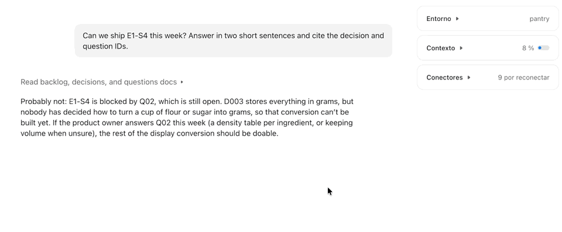

# Lupita

**Your agent says `D23`, `L04`, `E2-S4`. Lupita tells you what they mean.**

Point at any reference, in any app, press a shortcut, and read its definition from your repos.

Coding agents (Claude Code, Cursor, Devin, Copilot…) keep their memory in Markdown files
and cite it by ID: *"as decided in D23, and pending Q07, I applied L34"*. The agent knows
what those are. You don't remember. Lupita is a macOS menu bar app that shows the definition
of the reference under your pointer, in any app: an agent chat, an editor, a terminal, a
browser.



**[⬇ Download Lupita for macOS](https://github.com/manubarranco/lupita/releases/latest/download/Lupita.zip)** (Apple Silicon, macOS 14 or later)

[Leer en español](README.es.md)

## How it works

1. **It indexes your repos.** You register one or more folders (`~/Repos` by default). Lupita
   finds the git repos inside and reads their `.md` files, looking for IDs that are
   **defined** somewhere, not just mentioned. Prefixes are discovered, not configured:
   `D`, `Q`, `ADR`, `QL`, `E2-S3b` or whatever your agents invented.
2. **You point and press ⌃⌥⌘** (the three keys together, then release). Lupita reads the
   word under the pointer: through macOS Accessibility when the app exposes its text, or
   with on-device OCR of a small strip around the pointer when it doesn't (VS Code, Cursor,
   Claude, browsers).
3. **A tooltip shows** the ID, its title, two or three lines of its definition, the repo and
   file, and how many times it is cited. Click to open the file at that line; Esc closes it.

The index stays fresh on its own: a file watcher reindexes the repo that changed, and an
ID that was written seconds ago is found anyway.

### What counts as a definition

| Format | Example |
|---|---|
| Heading | `## D23 — Use SQLite` · `### Q07: How many repos?` |
| List or line start | `- **L34**: never parse HTML with regex` · `Q07: …` |
| First table column | `\| E2-S3 \| Voice input \| … \|` · `\| **E8-S6 Gift coins [Could]** \|` |
| File name | `docs/adr/ADR-004-storage.md` · `decisions/D23.md` |
| Frontmatter | `id: ADR-004` |

Everything else is a mention. Sections *about* an ID (`## D34 part 2`) and priority labels
(`## P1`) are recognised and kept out of the way.

### Which repo, when IDs collide

`D001` usually exists in every repo. Lupita picks the right one by, in order: a repo named
right before the ID, a repo named in the file you are reading, the repo of the active
window, the nearest folder. When the definition comes from another repo, the tooltip says so.

## Make your agents easy to look up

Lupita works with what agents already write, but it is exact when every reference is defined
like this. Add it to your `AGENTS.md` or `CLAUDE.md`:

```markdown
Define every decision, question, lesson or story you create as a heading
`## ID — Title`, followed by a one-line summary. Cite it by ID elsewhere.
```

See [`examples/demo-project`](examples/demo-project) for a small project that uses every
format.

## Install

Requires macOS 14 or later. The release build is for Apple Silicon; on an Intel Mac, build from source.

**From a release.** Download `Lupita.zip` from [Releases](../../releases), unzip it and move
`Lupita.app` to Applications. The app is not notarized yet, so the first time macOS blocks it: open
**System Settings → Privacy & Security**, scroll down and click **Open Anyway**.

**From source.** With Xcode or just the Command Line Tools (`xcode-select --install`):

```bash
git clone https://github.com/manubarranco/lupita.git
cd lupita
./scripts/bundle.sh
open build/Lupita.app
```

## Permissions and privacy

Lupita asks for two macOS permissions, and uses them only when you press the shortcut:

- **Accessibility**: for the shortcut and to read the exact text under the pointer.
- **Screen Recording**: to read a 600 × 80 pt strip around the pointer with Apple's Vision
  OCR, in apps that don't expose their text.

Everything happens on your Mac. Nothing is sent anywhere, and nothing you look up is
stored. Lupita only keeps its settings and the index of your Markdown files, in memory.

If you build from source, macOS forgets the permissions on every build unless the app is
signed with a stable certificate: create a self-signed **Code Signing** certificate named
`Lupita Dev` in Keychain Access, and `scripts/bundle.sh` will use it.

## Known limits

- In Electron apps and browsers the text comes from OCR (150-300 ms). Native apps answer
  through Accessibility (10-40 ms).
- Very short IDs read by OCR (`D5` from "DS") are shown as a suggestion, "Did you mean D5?",
  never as the answer.
- An ID cited from another repo without naming it resolves to the local one.
- Only Markdown files are indexed.

## Similar tools

- **macOS Look Up** (⌃⌘D) and [Lookupper](https://apps.apple.com/app/lookupper/id1667225994):
  the same gesture, for dictionary words.
- **[GitHub autolinks](https://docs.github.com/en/repositories/managing-your-repositorys-settings-and-features/managing-repository-settings/configuring-autolinks-to-reference-external-resources)**
  and **JetBrains issue navigation**: turn fixed prefixes into links, inside their own tool.
- **[VS Code ADR Manager](https://github.com/adr/vscode-adr-manager)**, **[Backlog.md](https://github.com/MrLesk/Backlog.md)**:
  keep decisions and tasks in Markdown for agents.

Lupita is for the moment in between: you are reading an agent's output, anywhere, and need to
know what it is citing.

## Development

```bash
./scripts/test.sh                 # tests (works without Xcode)
swift run lupita index ~/Repos      # index and print stats
swift run lupita D23 --repo myrepo  # resolve an ID from the terminal
swift run lupita report ~/Repos     # accuracy report (HTML, stays local)
```

Design decisions: [`docs/decisions.md`](docs/decisions.md), written in the same format Lupita reads.
Debug logging (what was looked up, by which method): `defaults write com.manubarranco.lupita debugLog -bool true`.

## License

[MIT](LICENSE)
