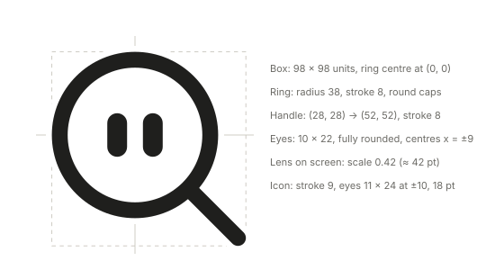
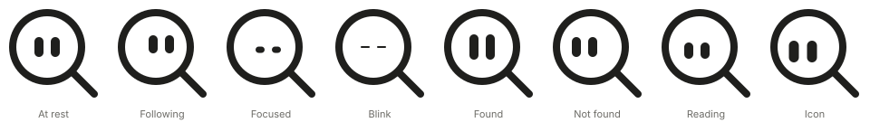

# Drawing Lupita

How to draw Lupita so it looks the same everywhere: the app, the README, the website, a
slide, a sticker. The numbers come from the app itself (`CursorLens.swift`,
`StatusMenu.swift`); when they change there, they change here. Why the character exists and
how it moves: [D17, D18](../decisions.md) and [lens-behavior.md](../lens-behavior.md).

## Who Lupita is

A magnifying glass that follows you and looks where you point. It has eyes and nothing
else: no mouth, no eyebrows, no arms. Everything it feels, it says with its eyes, and it
always looks at something (the pointer, the word, the answer, you). It is calm and attentive,
never loud.

## Construction

Everything is drawn in units, with the centre of the ring at (0, 0). Scale the whole
drawing, never its parts.

| Part | Measure |
|---|---|
| Bounding box | -42 to 56 on both axes (98 × 98 units). Its centre is (7, 7), not the ring's centre |
| Ring | Circle of radius 38, stroke 8, round caps |
| Handle | Straight line from (28, 28) to (52, 52), stroke 8, round caps. Always to the lower right |
| Eyes | Two rounded rectangles 10 × 22, corner radius 5 (full pill), centres at x = -9 and x = 9, y = 0 |
| Contour | Ring and handle are first drawn with stroke 14 in the surface colour, then with stroke 8 in ink. Not around the eyes |
| Lens fill | The disc inside the ring is filled with the surface colour, so text behind it does not show through |

Eyes move together, always. Looking is an offset applied to both: up to 7 units in any
direction, which keeps them inside the ring.

## Sizes

| Use | Size | Variant |
|---|---|---|
| Lens on screen | Scale 0.42, about 42 pt with the handle | Lens: filled disc, stroke 8 |
| Menu bar | 18 pt | Icon: no fill, stroke 9, eyes 11 × 24 at x = ±10, looking down-left |
| README, docs, avatars | 64 pt and up | Lens or icon, at rest |
| App icon (Finder, Dock, About) | 16 to 1024 px | Lens at rest on a white macOS plate, 5.6 px per unit at 1024 (`scripts/make-icon.swift`) |

Below 18 pt the eyes stop reading: use the icon variant there, never the lens. Leave clear
space of at least 10 units (the width of an eye) all around the bounding box.

## Expressions

Offsets are in units (x to the right, y down). Height is the eye height; width stays 10.

| Expression | Eye offset | Eye height | When |
|---|---|---|---|
| At rest | 0, 0 | 22 | Default. Still images use this one unless they tell a moment |
| Following | Towards the pointer, up to 7 | 20 | The lens is moving |
| Focused | Towards the pointer × 5, plus 3 down | 7 | The string is taut; searching the word |
| Blink | 0, 0 | Down to 2, for 0.15 s | Every 2 to 5 s at rest |
| Found | 0, 0 | 28, for 0.18 s, with a 6 pt hop | The answer appeared |
| Not found | Left, right, left (±7), then 0 | 22, then 14 | Nothing matched |
| Reading | Towards the text, sweeping ±5 | 18 | Reading the tooltip |
| Icon | -6, 5 (down-left) | 24 | Menu bar only |

## Colour

Lupita is one colour: the ink of the text around it. Dark ink on light surfaces, light ink
on dark ones; the lens disc takes the surface colour. The SVGs here switch on their own with
the system's light or dark mode.

| | Light | Dark |
|---|---|---|
| Ink (ring, handle, eyes) | `#1f1f1d` | `#f0efe9` |
| Disc | `#ffffff` | `#31312e` |

Over a background of the other tone (a dark editor while the system is in light mode, or the
reverse) the ink would vanish, so the ring and handle carry a **contour** in the surface
colour: 3 units on each side (stroke 14 under the stroke 8; 15 under the icon's 9). It is
the disc colour, so on a matching background it is invisible.

In the app it uses the system's label and control background colours instead, so it matches
macOS exactly. There is no brand colour yet; until there is one, do not add one.

## Don't

- Don't give it a mouth, eyebrows, cheeks or limbs. The eyes carry everything, and a face
  would bring it closer to other assistants' mascots (see D17).
- Don't draw goggles, a helmet or a visor around the eyes.
- Don't move the handle: always to the lower right, at 45°. Don't mirror or rotate Lupita.
- Don't put the eyes outside the ring, make them different sizes, or move one without the
  other.
- Don't use circles or dots for eyes: they are pills, taller than wide, except when focused
  or blinking.
- Don't add gradients, shadows inside the drawing or a second colour. The only outline is the surface-colour contour above.
  The lens on screen has a soft drop shadow so it reads over any background; that is the
  only one.
- Don't stretch it or change the stroke on its own: scale the whole drawing.

## Files

| File | What |
|---|---|
| [`lupita.svg`](lupita.svg) | Lupita at rest, lens variant. The default for docs and the README |
| [`lupita-icon.svg`](lupita-icon.svg) | Menu bar icon: no fill, heavier stroke, looking down-left |
| [`lupita-expressions.svg`](lupita-expressions.svg) | All expressions side by side |
| [`lupita-construction.svg`](lupita-construction.svg) | The grid and the measures |
| [`../../Resources/AppIcon.icns`](../../Resources/AppIcon.icns) | App icon, drawn by `scripts/make-icon.swift` |

The SVGs are drawn from the same numbers as this guide. Change the numbers here and in the
app together, then redraw them.
